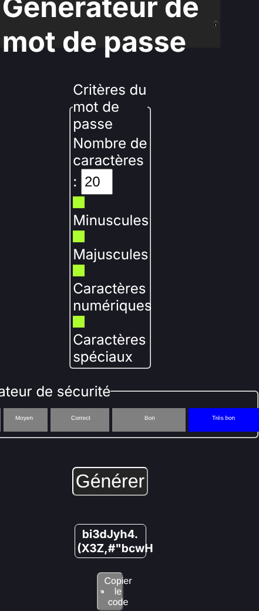
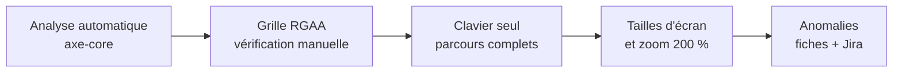

# ♿ Tests d'accessibilité et de compatibilité

> Projet réalisé dans le cadre de ma **formation de testeuse logicielle (ENI)**. J'ai audité deux applications web sur deux caractéristiques **non fonctionnelles** : l'**accessibilité** (RGAA 4.1 / WCAG 2.1) et la **compatibilité** (tailles d'écran et zoom).

---

## 🎯 En bref

| | Médiathèque | Générateur de mot de passe |
|---|:---:|:---:|
| Violations trouvées par l'outil automatique (axe-core) | 0 | 1 |
| Critères RGAA conformes (échantillon) | 10 / 13 (77 %) | 8 / 15 (53 %) |
| Utilisable au clavier seul | ✅ | ✅ |
| Affichage mobile (375 px) | ❌ | ❌ |
| Anomalies | 3 | 9 |

**Ce que montre ce projet : un outil automatique ne suffit pas.** axe-core trouve **1** anomalie. La vérification manuelle et les essais au zoom en trouvent **9 autres**, dont la plus grave : l'indicateur de sécurité du générateur est un dessin (`<canvas>`) sans aucune alternative, donc **un utilisateur aveugle ne peut pas savoir si son mot de passe est sûr**.

---

## 📂 Les documents

| # | Document | Contenu |
|:---:|---|---|
| 1 | [Audit d'accessibilité](docs/01-audit-accessibilite.md) | Méthode, résultats axe-core, grille RGAA (15 critères), navigation au clavier |
| 2 | [Tests de compatibilité](docs/02-compatibilite.md) | Matrice des tailles d'écran et du zoom, captures, analyse des causes |
| 3 | [Anomalies](docs/03-anomalies.md) | 12 anomalies, 2 fiches détaillées (ACC-02, COMP-04) |
| — | [`anomalies/jira-anomalies.csv`](anomalies/jira-anomalies.csv) | Les 12 anomalies au format d'import Jira |
| — | [`docs/captures/`](docs/captures/) | 12 captures : 5 tailles d'écran × 2 applications + focus clavier |

## 🧪 Applications testées

| Application | Description | Pour la lancer |
|---|---|---|
| **Médiathèque** | Catalogue de livres : ajout, emprunt, retour, suppression (Flask + page web) | `pip install flask` puis `python applications/mediatheque/app.py` → http://127.0.0.1:5000 |
| **Générateur de mot de passe** | Page web statique (HTML / JavaScript) | `cd applications/generateur && python -m http.server 5001` → http://127.0.0.1:5001 |

## 🔎 Démarche

1. **Analyse automatique** avec axe-core (le moteur de l'extension axe DevTools) : rapide, mais limitée.
2. **Grille RGAA** : 15 critères choisis pour couvrir les images, les couleurs, les formulaires, la structure et les messages.
3. **Clavier seul** : chaque parcours (générer un mot de passe, emprunter un livre, ajouter un livre invalide) réalisé sans souris.
4. **Compatibilité** : 5 configurations d'affichage par application, avec une capture à chaque fois.
5. **Anomalies** : une fiche par problème, avec la référence RGAA / WCAG, la sévérité et une proposition de correction.

## 🐞 Anomalies principales

| ID | Constat | Sévérité |
|---|---|:---:|
| ACC-02 | Indicateur de sécurité (`<canvas>`) sans alternative : niveau inconnu au lecteur d'écran | **Critique** |
| ACC-04 | Textes de l'indicateur : blanc sur jaune, contraste **1,07:1** (minimum 4,5:1) | Majeure |
| ACC-07 | Champ « Emprunteur » sans étiquette : axe-core l'accepte (placeholder), le RGAA non | Majeure |
| COMP-01 | Mobile : indicateur coupé à gauche et **inatteignable** (un contenu centré déborde des deux côtés) | Majeure |
| COMP-04 | Mobile et zoom 200 % : le tableau de la Médiathèque fait défiler toute la page | Majeure |

## ✅ Compétences

Accessibilité numérique (RGAA 4.1, WCAG 2.1 AA) · axe-core / axe DevTools · test au clavier · calcul de contrastes · tests de compatibilité (responsive, zoom) · rédaction de fiches d'anomalie · import Jira
